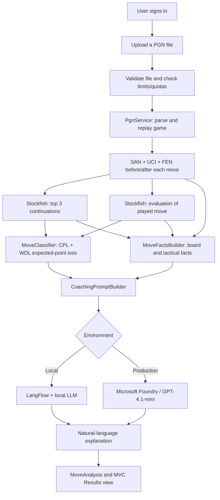

# Chess NLP Coach

**Understand the reasoning behind chess moves, not just the engine's recommendations.**

Chess NLP Coach is an experimental chess-analysis web application built with **ASP.NET Core MVC (.NET 10)**, **Stockfish**, and a **large language model (LLM)**. It combines engine evaluations with application-generated chess facts to produce explanations intended to be more approachable for beginner and improving players.

The project supports **LangFlow for local LLM experimentation** and **GPT-4.1-mini through Microsoft Foundry for production**.

> **Project status:** Experimental/learning project. Engine evaluations provide the analytical foundation, but AI-generated explanations may still contain mistakes and should not be treated as authoritative chess instruction.

## Table of contents

- [Motivation](#motivation)
- [Features](#features)
- [Technology stack](#technology-stack)
- [How the application works](#how-the-application-works)
- [Prerequisites](#prerequisites)
- [Getting started: local development](#getting-started-local-development)
- [Optional: running with Docker](#optional-running-with-docker)
- [Production deployment overview](#production-deployment-overview)
- [Security and usage limits](#security-and-usage-limits)
- [Limitations and future improvements](#limitations-and-future-improvements)
- [Contributors](#contributors)

## Motivation

Conventional chess engines are exceptionally good at identifying strong moves, but their output is not always easy for beginners to understand.

- Chess analysis tools commonly display recommended moves in **Standard Algebraic Notation (SAN)**, such as `Nf3`, `Rxe5`, or `O-O`.
- Players who are new to chess may struggle to interpret that notation and connect it to what is happening on the board.
- Even after understanding the notation, a recommended move alone does not answer the more important question: **Why is this move better?**
- Raw engine evaluations and principal variations also require chess knowledge to interpret.

**Chess NLP Coach attempts to bridge that gap.** Rather than asking an LLM to invent an analysis from scratch, the ASP.NET Core application interprets structured information from Stockfish, calculates move quality, derives verifiable facts about the position, and supplies those facts to an LLM for a more readable explanation.

The goal is to turn engine output into accessible chess coaching while keeping the underlying analysis grounded in actual board positions.

## Features

- **PGN upload:** Analyse games exported in Portable Game Notation (`.pgn`).
- **Game replay and move context:** Parse moves into SAN, UCI coordinates, and before/after FEN positions.
- **Stockfish engine integration:** Request the top three candidate moves and evaluate the move actually played.
- **Move scoring and classification:** Calculate centipawn loss and use Stockfish's **Win/Draw/Loss (WDL)** information to estimate expected-point loss and classify move quality.
- **Board-aware explanations:** Describe actual piece movement, captures, and relevant tactical opportunities using deterministic application logic.
- **Natural-language coaching:** Send structured analysis to an LLM to explain engine recommendations in beginner-friendly language.
- **Web interface:** View move-by-move analysis in an ASP.NET Core MVC application.
- **Authentication:** Protect analysis functionality using ASP.NET Core Identity with a SQL Server-backed user store.
- **Resource protection:** Apply upload-size, move-count, request-rate, and per-user daily quota limits.

## Technology stack

| Component | Technology | Purpose |
| --- | --- | --- |
| Web application | C#, ASP.NET Core MVC, .NET 10 | User interface, request handling, and orchestration |
| Chess engine | Stockfish 19 | Position evaluation, candidate moves, principal variations, and WDL |
| PGN processing | Gera.Chess + application parsing | Validate/replay games and derive move context |
| Move analysis | C# application services and helpers | Calculate scores, classify moves, and derive board facts |
| Local NLP | LangFlow with a configured LLM (for example, Ollama) | Experiment with prompts and natural-language responses |
| Production NLP | GPT-4.1-mini deployed through Microsoft Foundry | Generate natural-language explanations in the deployed application |
| Authentication and data | ASP.NET Core Identity, Entity Framework Core, SQL Server / Azure SQL | User accounts and analysis quotas |
| Containerization | Docker | Package the application and Stockfish |
| Hosting and delivery | Azure App Service, Azure Container Registry, GitHub Actions | Container hosting and CI/CD |

### Key components

**1. Stockfish — the analysis engine**

Stockfish evaluates the position before each move, identifies its preferred continuations, and supplies evaluation scores. The application evaluates the player's actual move separately if that move is not already among Stockfish's top suggestions.

**2. Application logic — interpreting and classifying engine data**

The C# application converts chess data into a structured, human-readable context. Its responsibilities include PGN processing, SAN/UCI/FEN interpretation, candidate ranking, centipawn-loss calculation, WDL-based expected-point-loss classification, move descriptions, and extraction of supported tactical facts.

**3. NLP/LLM — communicating the analysis**

The LLM receives the structured analysis and rewrites it into a more accessible explanation. The intended separation of responsibilities is:

- **Stockfish decides how the position evaluates.**
- **C# calculates classifications and determines board facts.**
- **The LLM explains those supplied findings in plain language.**

This design helps reduce unsupported statements, although it cannot eliminate LLM hallucinations entirely.

## How the application works



### Example of the intended outcome

| Traditional engine output | More accessible coaching |
| --- | --- |
| `Nf3` | “Move the white knight to f3, where it develops toward the centre.” |
| `Rxe5` | “Move the rook to e5 and capture the piece on that square.” |

*These are illustrations of the desired output style, not verified recommendations for a particular position. Actual explanations depend on the board position and engine analysis.*

### How move quality is determined

The application retains **centipawn loss (CPL)** as one measure of how much evaluation was lost, but primarily uses **expected-point loss** derived from Stockfish's WDL information when classifying move quality.

This matters because the practical significance of a small evaluation change depends on the position. A loss of advantage in a roughly equal game can matter more than a similar numerical change in a position that is already decisively winning.

The result is a move-quality label, along with supporting evaluation details that are used to build the coaching explanation.

## Prerequisites

For **local development** on Windows, install:

1. **.NET 10 SDK** — [Download .NET](https://dotnet.microsoft.com/download/dotnet/10.0).
2. **Visual Studio 2022** with ASP.NET and web-development tooling, or another .NET-capable editor.
3. **SQL Server** (such as SQL Server Express / Developer Edition) or access to **Azure SQL Database**.
4. **Stockfish 19** (Windows executable) — [Official Stockfish website](https://stockfishchess.org/).
5. **LangFlow** — [LangFlow documentation](https://docs.langflow.org/) — and an LLM provider configured inside the flow. A local Ollama model is one option.
6. **Git** to clone the repository.
7. **EF Core CLI tools** if you intend to apply migrations using `dotnet ef`.

For **container-based development**, Docker Desktop is additionally required. For **production**, an Azure subscription and a configured Microsoft Foundry model deployment are required.

## Getting started: local development

The steps below describe the newer application architecture with SQL Server, Identity, and LangFlow. The public repository may not contain every newer change until it has been pushed.

### Step 1 — Clone the repository

```powershell
git clone https://github.com/calvinsim2/ChessNLPCoachApp.git
cd ChessNLPCoachApp
```

### Step 2 — Restore dependencies

```powershell
dotnet restore ChessNLPCoachApp.slnx
```

### Step 3 — Set up a SQL Server database

Create or use an existing SQL Server instance. The following examples assume a local SQL Server Express instance and a database called `ChessDB`.

From the repository root, configure the connection string with **.NET User Secrets**:

```powershell
dotnet user-secrets init --project ChessNLPCoachApp/ChessNLPCoachApp.csproj

dotnet user-secrets set "ConnectionStrings:DefaultConnection" "Server=localhost\SQLEXPRESS;Database=ChessDB;Trusted_Connection=True;TrustServerCertificate=True;" --project ChessNLPCoachApp/ChessNLPCoachApp.csproj
```

User Secrets keep development credentials out of tracked `appsettings.json` files. For Azure SQL or SQL authentication, use an appropriate connection string instead.

### Step 4 — Configure a local login account

The newer application uses **ASP.NET Core Identity**. In the Development environment, it can seed a test account using credentials from User Secrets:

```powershell
dotnet user-secrets set "SeedUser:Username" "localtester" --project ChessNLPCoachApp/ChessNLPCoachApp.csproj

dotnet user-secrets set "SeedUser:Password" "REPLACE_WITH_A_STRONG_TEST_PASSWORD" --project ChessNLPCoachApp/ChessNLPCoachApp.csproj
```

Use a unique password that satisfies the project's Identity policy (including the minimum length of 10 characters). Do **not** use a real account password or hard-code production credentials.

### Step 5 — Apply Entity Framework Core migrations

If the .NET EF Core CLI tool is not installed, install it:

```powershell
dotnet tool install --global dotnet-ef
```

Then apply the migrations **already present in your version of the project**:

```powershell
dotnet ef database update --project ChessNLPCoachApp/ChessNLPCoachApp.csproj --startup-project ChessNLPCoachApp/ChessNLPCoachApp.csproj
```

This creates or updates the application tables in the configured database. If you are using an older checkout that has no Identity/EF Core migrations, first update the source to the newer version before following this step.

### Step 6 — Configure Stockfish

Download Stockfish and extract the executable to a known local location, for example:

```text
C:\stockfish\stockfish-windows-x86-64-universal.exe
```

Set the matching path and desired search depth in your development configuration (`ChessNLPCoachApp/appsettings.Development.json`), creating the file if needed:

```json
{
  "Stockfish": {
    "Path": "C:\\stockfish\\stockfish-windows-x86-64-universal.exe",
    "Depth": 18
  }
}
```

**Important:** Update the path if your executable has a different name or location. The Docker image uses a **Linux** Stockfish binary instead of this Windows path.

### Step 7 — Run LangFlow and configure the local LLM

1. Install and launch **LangFlow**.
2. Configure a flow that accepts the analysis prompt and returns a text explanation.
3. Connect the flow to an LLM. If you choose **Ollama**, install Ollama, download a suitable local model, and confirm LangFlow can communicate with it.
4. Copy the flow ID and the API key required by your LangFlow setup.

For versions of this project that use the `LangflowClient` implementation, set these environment variables in **the same PowerShell session** before launching the app:

```powershell
$env:LANGFLOW_BASE_URL = "http://localhost:7860"
$env:LANGFLOW_FLOW_ID = "YOUR_LANGFLOW_FLOW_ID"
$env:LANGFLOW_API_KEY = "YOUR_LANGFLOW_API_KEY"
```

The LangFlow flow must be running while the MVC application requests explanations. These variables are read as **process environment variables** in the newer local client, so setting unrelated keys in User Secrets alone will not supply them.

### Step 8 — Run the web application

From the repository root:

```powershell
dotnet run --project ChessNLPCoachApp/ChessNLPCoachApp.csproj --environment Development
```

Open the local HTTPS or HTTP URL printed in the terminal. Sign in with the development user configured above, upload a `.pgn` file, and inspect the move-by-move analysis.

### Step 9 — Try a sample PGN

Create a small `.pgn` file or export a short game from a chess platform. The application validates the file, replays its moves, sends each position for engine analysis, and returns a results page with classifications and explanations.

For initial testing, use a short game: engine analysis and LLM requests are performed for multiple moves and may take time.

## Optional: running with Docker

The repository contains a `Dockerfile` that builds the **.NET 10** application, installs the **Linux Stockfish 19** executable, exposes port **8080**, and starts the MVC app.

Build the image from the repository root:

```powershell
docker build -t chessnlp:local .
```

Create a **local, untracked** environment file (for example, `.env.docker`) containing the actual settings required by your deployment:

```dotenv
ASPNETCORE_ENVIRONMENT=Development
ConnectionStrings__DefaultConnection=YOUR_SQL_CONNECTION_STRING
SeedUser__Username=localtester
SeedUser__Password=REPLACE_WITH_A_STRONG_TEST_PASSWORD
LANGFLOW_BASE_URL=http://host.docker.internal:7860
LANGFLOW_FLOW_ID=YOUR_LANGFLOW_FLOW_ID
LANGFLOW_API_KEY=YOUR_LANGFLOW_API_KEY
```

Start the container:

```powershell
docker run --rm -p 8080:8080 --env-file .env.docker chessnlp:local
```

Visit `http://localhost:8080`.

**Docker notes:**

- Do not commit `.env.docker` or any file containing real credentials.
- `host.docker.internal` allows a Docker Desktop container to reach a LangFlow server on the host machine.
- A Windows-authenticated `localhost\SQLEXPRESS` connection string generally cannot be reused unchanged in a Linux container. Configure a SQL Server endpoint reachable from the container and a supported authentication method.
- `Stockfish__Path` is configured in the Dockerfile as `/usr/local/bin/stockfish`.
- When the image is rebuilt after source changes, restart the container with the newly built image.

## Production deployment overview

The production architecture uses a containerized ASP.NET Core MVC application and a hosted LLM:

| Service | Production role |
| --- | --- |
| Azure App Service (Linux container) | Hosts the MVC application |
| Azure Container Registry | Stores the application Docker image |
| Azure SQL Database | Stores Identity users and analysis-quota data |
| Microsoft Foundry | Hosts the `gpt-4.1-mini` model deployment |
| GitHub Actions | Builds and publishes updated container images |

### Suggested deployment sequence

1. **Provision Azure resources:** Create or select the resource group, Azure Container Registry, Linux App Service plan/web app, Azure SQL logical server/database, and Microsoft Foundry project/model deployment.
2. **Deploy GPT-4.1-mini:** Note the configured endpoint, deployment name, and authentication mechanism required by your production LLM client.
3. **Prepare the database:** Restrict network access appropriately, supply the Azure SQL connection string to App Service configuration, and apply EF Core migrations.
4. **Configure app settings and secrets:** Store production connection strings and Foundry credentials in Azure-managed configuration (prefer managed identity or Key Vault where supported). Do not embed secrets in Docker images or GitHub source.
5. **Select the production LLM client:** Ensure the deployed code actually calls the Microsoft Foundry model rather than the local `LangflowClient`; model deployment alone does not automatically switch the application to a different API.
6. **Build and publish the image:** Use GitHub Actions to build the Docker image, push it to Azure Container Registry, and deploy the new image to App Service.
7. **Verify the running app:** Confirm database connectivity, authentication, Stockfish execution, LLM connectivity, PGN upload, and output rendering.
8. **Configure operational protections:** Check request timeouts, resource quotas, Azure Monitor/logging, and Azure Cost Management budgets/alerts before wider use.

> **Cost and timeout considerations:** Analysing longer PGNs may require many sequential Stockfish and LLM operations. Reverse-proxy or App Service request timeouts can interrupt an in-progress analysis. Azure budgets provide cost alerts; they do **not** automatically stop all resources at a spending threshold.

The exact production setting names depend on the Microsoft Foundry client implementation in the deployed code.

## Security and usage limits

The newer application includes safeguards to limit accidental or malicious resource usage:

| Protection | Current configured limit / behavior |
| --- | --- |
| Authentication | Login required before using the analysis page |
| Password handling | ASP.NET Core Identity password hashing |
| PGN file size | 64 KiB maximum |
| Game length | 80 plies (half-moves) maximum |
| Daily quota | 3 accepted game analyses per user per UTC day |
| Upload rate | 10 attempts per authenticated user per hour |
| Concurrent work | At most one analysis per application instance |
| Antiforgery | Upload POST action validates antiforgery tokens |

These values are defined in the application configuration/code and may change in later releases. The concurrency restriction is **per instance**, not a global lock across multiple replicas.

**Security reminders:** Keep SQL and LLM credentials out of source control; secure Azure database access; use HTTPS; and monitor application/LLM usage and spending. This project is experimental and should undergo a production security review before broad public access.

## Limitations and future improvements

This application is designed as a learning experiment and still has areas to improve:

- **LLM accuracy:** Generated explanations may misunderstand a position even when provided with deterministic facts.
- **Long-running requests:** Analysing an entire game synchronously can exceed web-request time limits. A background-job pipeline with progress updates would make larger games more reliable.
- **Chess explanation coverage:** Positional concepts can be harder to derive deterministically than captures, movement, and simple tactics.
- **Scoring interpretation:** Move-quality categories are application-defined heuristics based on engine output, not official chess grades.
- **Scale and cost:** Engine compute time and hosted model requests increase with game length.

Potential enhancements include queued analysis jobs, persistent analysis history, interactive chessboard visualization, explanation feedback, stronger tactical fact validation, and caching of repeated positions.

## Contributors

**Project author and maintainer:** [@calvinsim2](https://github.com/calvinsim2)

Contributions, suggestions, bug reports, and improvements are welcome. Please use the repository's [Issues](https://github.com/calvinsim2/ChessNLPCoachApp/issues) or [Pull Requests](https://github.com/calvinsim2/ChessNLPCoachApp/pulls) pages to discuss changes.

---

**Chess NLP Coach** is an experimental project exploring how traditional chess-engine analysis can be combined with C# application logic and natural-language AI to make chess learning more accessible.
